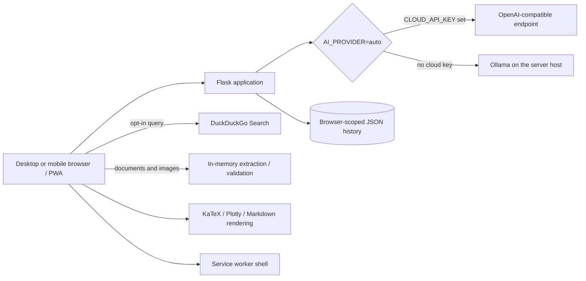

# All-in-One AI Studio

A responsive Flask/PWA chat studio with local Ollama inference, optional
OpenAI-compatible cloud inference, image and document input, web search,
mathematical typesetting, Plotly charts, browser voice, and a restricted local
Python snippet runner.

## What it does

- **Hybrid inference:** with `AI_PROVIDER=auto` (the default), a configured
  `CLOUD_API_KEY` routes prompts to the configured OpenAI-compatible cloud
  endpoint; without a cloud key, the app uses local Ollama. `AI_PROVIDER=local`
  and `AI_PROVIDER=cloud` explicitly select an engine.
- **Local model defaults:** `qwen2.5:14b`, kept loaded for 30 minutes, with a
  4096-token context, temperature `0.3`, and repeat penalty `1.15`. The
  default local vision model is `qwen2.5vl:7b`.
- **Multimodal chat:** upload PNG, JPEG, or WebP images for a vision-capable
  Ollama or cloud model. PDFs, TXT, PY, CSV, and Markdown are extracted in
  memory, divided into overlapping chunks, then the most relevant chunks are
  selected for the prompt. Uploads and image bytes are not written to history.
- **Web Search:** an explicit 🌐 toggle uses the DuckDuckGo-supported `ddgs`
  metasearch library to retrieve up to five results without a key. Their URLs are
  sent as reference context and shown as clickable citations. The search query
  leaves the device when this is enabled.
- **Math and graphs:** Markdown supports KaTeX inline/block math; a fenced
  `plotly` block containing a JSON figure renders as an interactive chart.
- **Restricted Python:** Python code blocks get a Run button only in local
  Ollama mode. The server interprets a limited subset of expressions, variables,
  conditionals, bounded `range()` loops, and basic collections/math; it does not
  execute arbitrary Python, imports, file/network/process calls, or attributes.
  Code and evaluation are limited to 5 seconds and bounded inputs/outputs.
- **PWA and chat tools:** responsive mobile drawer, dark/light themes, JSON chat
  history, Markdown export, response-style selection, browser speech input,
  natural voice selection, and adjustable speech rate.

## Architecture



In a public deployment, inference uses the configured provider running outside
your laptop. When a cloud key is configured, prompts go to that provider and
your laptop's Ollama process is not used. If no key is set, local mode targets
Ollama on the **server host**, never a visitor's device. The public deployment
configuration disables code execution even if its provider is unavailable.

## Requirements

- Python 3.10 or newer
- Ollama for local inference; download a compatible model before chatting
- A modern browser; Web Speech API availability varies by browser and platform
- Optional OpenAI-compatible API key for hosted inference

## Run locally

### macOS and Linux

```sh
python3 -m venv .venv
source .venv/bin/activate
python -m pip install --upgrade pip
python -m pip install -r requirements.txt
ollama pull qwen2.5:14b
ollama pull qwen2.5vl:7b
python app.py
```

The application listens on **http://127.0.0.1:8080**. Ollama must be running on
the same computer. The vision model is optional until you attach an image. If
disk space or memory is limited, set `OLLAMA_MODEL` to another installed model.

### Windows PowerShell

```powershell
py -m venv .venv
.\.venv\Scripts\Activate.ps1
python -m pip install --upgrade pip
python -m pip install -r requirements.txt
ollama pull qwen2.5:14b
ollama pull qwen2.5vl:7b
python app.py
```

Open http://127.0.0.1:8080. For a trusted local network demonstration, set
`HOST=0.0.0.0` before starting and visit the host computer's LAN address from
the phone. Do not expose the Flask development server or Ollama port directly to
the public internet.

## Configuration

Copy `.env.example` to `.env`. Never commit provider keys:

```dotenv
AI_PROVIDER=auto
APP_MODE=local
OLLAMA_HOST=http://127.0.0.1:11434
OLLAMA_MODEL=qwen2.5:14b
OLLAMA_VISION_MODEL=qwen2.5vl:7b
FLASK_SECRET_KEY=replace-with-a-long-random-secret
COOKIE_SECURE=false
```

### Cloud provider

For Groq (OpenAI-compatible API), set:

```dotenv
CLOUD_API_KEY=your-provider-key
CLOUD_BASE_URL=https://api.groq.com/openai/v1
CLOUD_MODEL=llama-3.3-70b-versatile
```

`CLOUD_BASE_URL` is an API endpoint, not the provider's marketing website URL.
You can use another compatible service, including OpenRouter or Gemini's
OpenAI-compatible endpoint, by setting `CLOUD_BASE_URL` and `CLOUD_MODEL` to
that provider's documented API endpoint and model. The legacy
`GROQ_API_KEY`/`GROQ_BASE_URL`/`GROQ_MODEL`, `OPENROUTER_*`, and `OPENAI_*`
variables are also supported when `CLOUD_API_KEY` is absent.

An API key does **not** make usage guaranteed free. Provider free tiers, model
availability, rate limits, and terms can change; some accounts or models are
paid. Confirm current pricing and set provider-side usage budgets before
publishing a link. A public app using your key can consume your quota.

### Vision models

For local image analysis, the selected Ollama model is switched to
`OLLAMA_VISION_MODEL` when necessary. The default is `qwen2.5vl:7b`; install it
with `ollama pull qwen2.5vl:7b`. Cloud vision requests require a vision-capable
model configured in `CLOUD_MODEL`. Text-only models may reject images.

## Free cloud deployment (Render)

1. Push the project to a Git provider and create a Render Web Service using the
   included `render.yaml` Blueprint.
2. Set `CLOUD_API_KEY` in Render's environment settings. The default endpoint
   and model target Groq-compatible chat; override `CLOUD_BASE_URL` and
   `CLOUD_MODEL` for a provider/model currently available to your account.
3. Keep `AI_PROVIDER=auto` and `APP_MODE=public`. Render supplies HTTPS and the
   config generates a Flask session secret. Never put a key in source control,
   HTML, or JavaScript.
4. Deploy and use the service URL. The hosted app does not connect to your
   laptop; public mode disables the local Python runner.

The included Render service uses the free plan where available. Free hosting is
not a 24/7 uptime guarantee: Render may sleep free services, impose quotas, or
change its free offering. A provider can also rate-limit or discontinue a free
model. Cloud requests can incur charges depending on the provider/account.
Conversation JSON is stored on the service filesystem and may be lost when an
ephemeral instance restarts or redeploys. The app has no user sign-in or shared
API-key protection; treat any public deployment as an untrusted, multi-user
service and monitor usage.

`Procfile` and `render.yaml` run Gunicorn on the host-provided port. The local
development server in `app.py` uses fixed port 8080.

## Data handling and safety notes

- Browser history is isolated by a signed session cookie and stored as JSON on
  the server. Images are sent to the selected AI engine but are not stored in
  conversation JSON or on disk. Documents are extracted in memory and are not
  stored as uploaded files.
- The optional web-search toggle sends the search query to DuckDuckGo and sends
  retrieved snippets/URLs to the selected AI provider as context.
- Local mode sends prompts to the Ollama service configured by `OLLAMA_HOST`.
  Cloud mode sends prompt text and any attached images to the configured
  provider. Do not include sensitive information unless allowed by the
  applicable provider and organizational policy.
- The Run Code feature is a bounded AST interpreter, not a general Python
  runtime. It rejects imports, attributes, and unsupported syntax; it is not
  intended for arbitrary programs or untrusted code execution.
- Markdown is sanitized in the browser. KaTeX, Plotly, Marked, Highlight.js, and
  DOMPurify are loaded from public CDNs; math/plot rendering needs network access
  unless those assets are separately self-hosted.
- Browser speech recognition may use a browser vendor's remote service, and
  speech synthesis depends on voices installed by the operating system/browser.
- Free search engines may throttle automated queries or present anti-bot
  challenges; search can therefore return no results or fail temporarily. The
  UI reports that condition rather than claiming the answer has citations.

## API

| Method | Path | Purpose |
|---|---|---|
| `GET` | `/` | Responsive PWA |
| `GET` | `/api/status` | Provider, models, latency, public-mode capabilities |
| `GET` | `/api/chats` | Current browser's conversations |
| `GET` | `/api/chats/<id>` | Load conversation |
| `PATCH` | `/api/chats/<id>` | Rename conversation |
| `DELETE` | `/api/chats/<id>` | Delete conversation |
| `GET` | `/api/chats/<id>/export.md` | Download Markdown |
| `POST` | `/api/chat/stream` | SSE chat (`token`, `sources`, `done`, `error`) |
| `POST` | `/api/run-code` | Execute restricted local snippet (disabled in public/cloud mode) |
| `POST` | `/upload` | Extract documents or validate images, in memory |

Chat requests may include `style: "concise" | "steps"`, `web_search: true`,
`search_query`, and an `images` array of `{name, mime_type, data}` where `data`
is base64-encoded. The client sends SSE events incrementally and renders source
citations after a completed search-backed response.

## Tests

```sh
python -m unittest discover -s tests -v
```

## Academic and ethical AI disclaimer

This educational application is not a source of professional, medical, legal,
or financial advice. Model output may be false, incomplete, biased, or
fabricated. Verify important claims using primary sources and inspect cited
pages. Respect copyright, privacy, consent, institutional policies, and
provider terms when analyzing documents. Local inference avoids sending prompts
to a third-party AI provider, but does not protect a device from local access or
misconfiguration.
